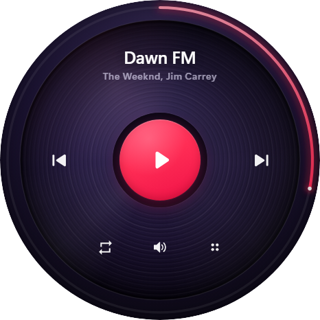
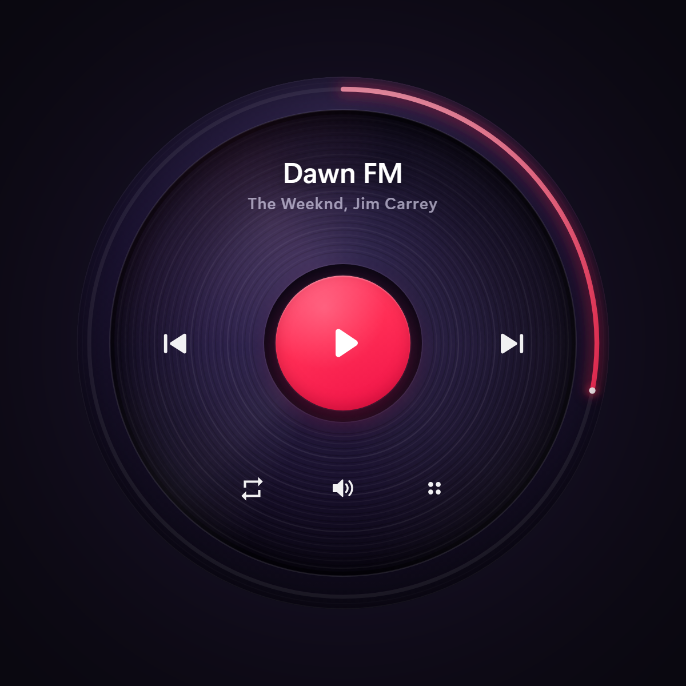
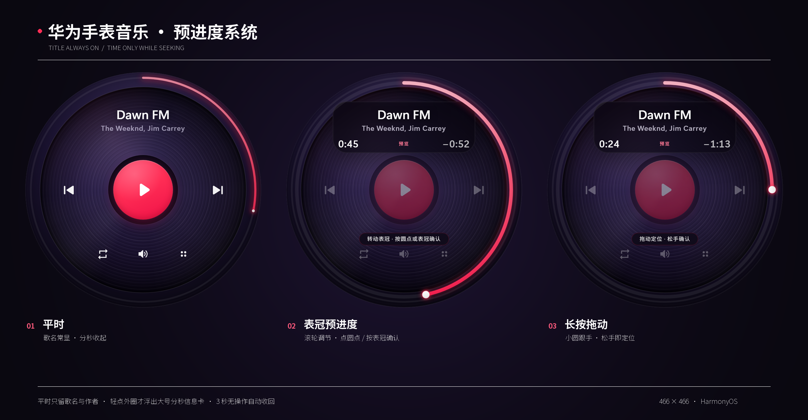
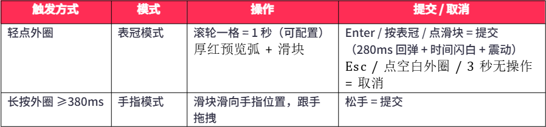
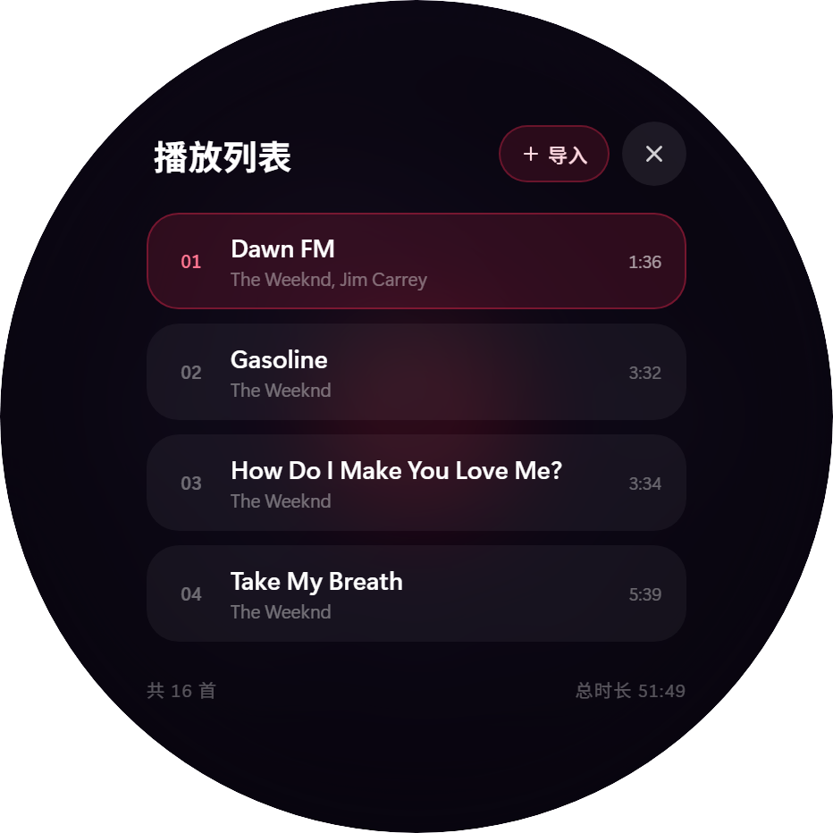

## 华为 GT Runner 表盘 · 交互式音乐播放器

界面设计方案与实现说明

单文件 HTML/CSS/JS 实现 · 466×466 圆形屏幕 · 鸿蒙扁平化风格

表盘渲染（466×466，透明背景，可直接用作贴图）

## 一、项目概述

本方案为华为 GT Runner 圆形表盘设计了一套完整的交互式音乐播放器界面，采用「黑胶唱片 + 红色播放中心 + 外圈进度弧」的视觉结构，风格对齐鸿蒙（HarmonyOS）扁平化设计语言。整个界面以单个 HTML 文件实现（无外部依
赖），圆形屏幕输出 466×466 分辨率，边缘裁切至圆形边界，可直接作为表盘贴图使用。

· 单文件交付：watch-music.html（约 1800 行，无外部依赖，双击即可运行）

· 真实音频播放：内置 Dawn FM 16 首专辑列表，支持本地文件导入（文件夹/多文件）

· 双模式进度调节：表冠滚轮模式 + 手指长按拖拽模式，带预览弧与提交回弹动画

· 信息分层：歌名/作者常显，分秒进度仅在调进度时浮出于最上层暗玻璃卡片

· 兜底机制：网页预览环境下浏览器拦截 file:// 音频时，自动弹出「载入本地音乐」面板

## 二、视觉设计

◆ 构图与配色

· 深色紫黑渐变背景（#0a0714 → #14102a），干净扁平，无外壳/表带/环境

· 中心黑胶唱片：同心圆纹路矢量绘制，播放中缓慢旋转

· 红色播放/暂停按钮（#FF2D55 渐变，118px），位于唱片圆心

· 五个白色功能图标固定布局：上一曲 / 循环 / 音量 / 菜单（2×2 四点，尊重原著）/ 下一曲

· 红色进度圆弧沿外圈（半径 222），滑块 2.8px 圆点 + 5px 光晕

· 顶部文字区：上行歌名（过长自动滚动跑马灯），下行作者名

 

整体预览（深色背景展示）

◆ 状态对照

三种状态：空闲 / 表冠调进度 / 手指拖拽调进度

## 三、交互设计

◆ 信息分层原则

真实手表屏幕空间有限，因此信息按「常显 / 临时浮层」分层：歌名与作者名始终显示；数字进度（左：已播 / 中：预览标记 / 右：−剩余）只在调节进度的瞬间浮出——20px 大字号、水平居中、置于最上层暗玻璃卡片内，调节结束 3 秒或取消后自动收回，还原干净的唱片画面。

◆ 双模式进度调节

调节过程中，真实进度弧保持白色细线持续走播，红色预览弧独立显示目标位置，提交时预览弧与实际弧以 280ms 缓动对齐，形成「回弹」手感。

◆ 其他交互

· 空闲时滚轮 = 调节音量（HUD 弧形音量条 0.72 默认）

· 四点多点图标 → 全屏播放列表：曲目行、页脚「共 N 首 / 总时长」、「+ 导入」按钮

· 键盘辅助：空格播放 / ←→切歌 / Enter 确认 / M 列表 / Esc 取消

· 循环模式：单曲循环 / 列表循环 / 单曲一次（点击循环图标切换，Toast 提示）

播放列表（内置 16 首 Dawn FM）

## 四、本地音乐播放

· 内置 Dawn FM 专辑 16 首（The Weeknd），文件直连 file:// 路径，双击 HTML 打开即真实播放

· 播放列表「+ 导入」：多文件选择，按文件名与现有曲目匹配则更新源、否则追加为新曲目（自动探测时长）

· 兜底面板：通过 http 网页预览打开时，浏览器拒绝 file:// 媒体，播放失败即弹出「载入本地音乐」卡片——点「选择 Dawn FM 文件夹」用目录选择器（webkitdirectory）一次性重新挂载全部曲目为 Blob URL，随后恢复播放

· 已挂载 Blob 源的曲目不会再误弹兜底面板（防重入保护）
 
 

兜底面板：选择 Dawn FM 文件夹

## 五、Dawn FM 曲目列表（16 首，总时长 51:49）

#	曲目	艺术家 	时长

1	Dawn FM	The Weeknd, Jim Carrey	1:36

2	Gasoline	The Weeknd	3:32

3	How Do I Make You Love Me?	The Weeknd	3:34

4	Take My Breath	The Weeknd	5:39

5	Sacrifice	The Weeknd	3:09

6	A Tale By Quincy	The Weeknd	1:36

7	Out of Time	The Weeknd	3:34

8	Here We Go… Again	The Weeknd, Tyler, The Creator	3:30

9	Best Friends	The Weeknd	2:44

10	Is There Someone Else?	The Weeknd	3:19

11	Starry Eyes	The Weeknd	2:28

12	Every Angel is Terrifying	The Weeknd	2:47

13	Don’t Break My Heart	The Weeknd	3:26

14	I Heard You’re Married	The Weeknd, Lil Wayne	4:24

15	Less Than Zero	The Weeknd	3:32

16	Phantom Regret by Jim	The Weeknd	3:00

## 六、技术实现要点

· 纯 HTML/CSS/SVG/JS，无框架无构建；圆形屏幕 = 466px 容器 + border-radius:50% + overflow:hidden

· 进度弧 = SVG stroke-dasharray 环形路径（半径 222 / 调节半径 212），requestAnimationFrame 逐帧推进

· 预览弧与实际弧分离：实际弧白色随播放走，预览弧红色随交互走，提交时 280ms ease 对齐

· 歌名跑马灯：双层文字 + CSS keyframes 横向滚动，仅在文字溢出宽度时启用

· 真实 <audio> 元素驱动本地曲目；无 src 的演示曲目用时间轴模拟播放

· 关键常量：SEEK_TIMEOUT=3000ms · LONG_PRESS=380ms · 轮盘 100delta=1s · 默认音量 0.72

· 已验证：file:// 直接双击播放（含中文/特殊字符文件名 …  ’ , ）、HTTP 预览 + 文件夹兜底、表冠/手指双模式全流程（headless Chrome 自动化测试）

七、交付文件

文件	说明

watch-music.html	可交互表盘界面（双击即可运行）

output/watch-face-466.png	466×466 透明圆形贴图（可直接用作表盘）

output/watch-face-932.png	932×932 高分辨率版本

output/watch-preview.png / watch-seek-states.png / watch-playlist.png	预览与状态截图

Dawn FM/*.mp3	本地音乐文件（16 首）

（这个灵感来源于我从高中一直用到现在的华为运动手表，我很喜欢听歌，里面存了很多歌曲，长的短的都有，甚至还有英语听力，但有一个致命的问题就是不能控制进度，只能从头听到尾，现在有了AI，终于可以让这个想法落地了，本项目使用deepseek harness完成，模型使用deepseek v4.1 flash）

李靖宇

2026.10.23
